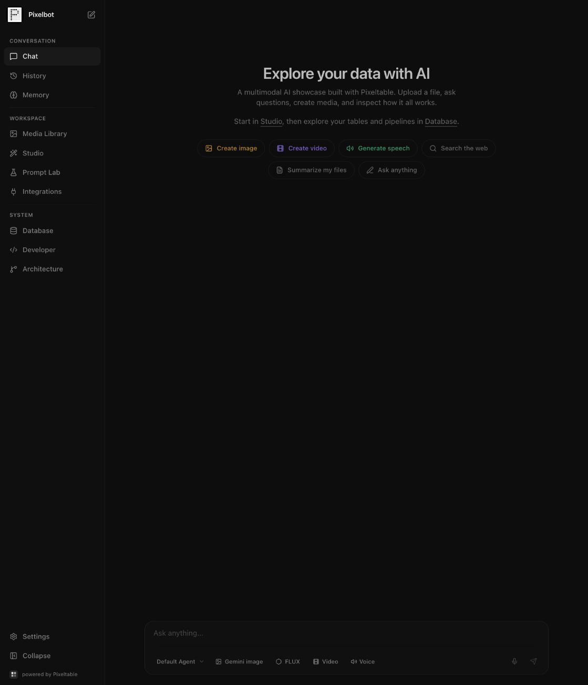

# Pixelbot

**See what you can build with [Pixeltable](https://github.com/pixeltable/pixeltable).**

Pixelbot is a local, open-source AI workbench: chat with documents and media, generate images and video, compare models, and explore the data behind every result. It demonstrates Pixeltable's multimodal tables, computed columns, iterator views, embedding indexes, tool calling, and HTTP serving in one runnable application.



## Explore the showcase

| Try this | See Pixeltable at work |
| --- | --- |
| Upload a PDF, image, video, or audio file in **Studio** | Native media columns; automatic summaries, captions, chunks, keyframes, and transcripts |
| Ask questions in **Chat** | Semantic retrieval, multimodal context, tool invocation, and searchable conversation history |
| Create media in **Media Library** | Image, video, and speech generation as stored computed columns |
| Save an answer to **Memory** | Persistent, searchable context for later questions |
| Import a CSV in **Studio** | Tables you can edit, query, export, and undo with version history |
| Open **Database** | Real schemas, rows, indexes, computation errors, joins, sampling, and pipeline lineage |
| Compare prompts in **Prompt Lab** | Provider SDK comparisons with inputs, outputs, timing, and errors stored in Pixeltable |

Pixeltable manages the data and computed pipeline; model providers perform the inference. Pixelbot uses FastAPI and React for the interface, without a separate vector database or agent orchestration framework. **Architecture** explains the design; **Database** shows the running catalog.

## Quick start

Requires Python 3.11+, Node.js 22.12+, and [uv](https://docs.astral.sh/uv/). The backend is pinned to **Pixeltable 0.7.18** for reproducible setup. Local CLIP and detection models download on first use and can require substantial disk space.

```bash
git clone https://github.com/pixeltable/pixelbot.git
cd pixelbot
cp .env.example backend/.env
```

Set `GEMINI_API_KEY` in `backend/.env` for chat, document processing, embeddings, and Gemini image/video generation. Add `OPENAI_API_KEY` for audio/video transcription and speech, or `BFL_API_KEY` for FLUX. Prompt Lab and notification integrations have optional keys in the same file. Provider usage may incur charges. CSV editing and catalog inspection work without provider keys.

```bash
# Build the interface first.
cd frontend
npm ci
npm run build

cd ../backend
uv sync --locked --group dev
export PIXELTABLE_HOME="$PWD/.pixeltable-v3"
uv run --env-file .env pxt schema update pixelbot/app.py pixelbot_v3 -f
uv run --env-file .env pxt service update pixelbot/app.py pixelbot_v3 app --port 8000 -f
```

Open **[localhost:8000](http://127.0.0.1:8000)**. Upload a file in Studio, ask about it in Chat, then inspect the computed results in Database. Interactive API docs are at [`/docs`](http://127.0.0.1:8000/docs).

Pixelbot is a single-user local showcase. Keep the service on localhost. Its catalog lives in `backend/.pixeltable-v3`; the older `agents` catalog is left alone.

## Build your own

The [application entry](backend/pixelbot/app.py) declares Pixeltable query routes and the FastAPI service. The [schema](backend/pixelbot/schema.py) defines the tables, views, indexes, and computed pipelines; [Python UDFs](backend/pixelbot/functions.py) extend them. Edit the declarations, apply them with `pxt schema update`, then restart HTTP with `pxt service update`.

Find more focused examples in [awesome-pixeltable-apps](https://github.com/pierrebrunelle/awesome-pixeltable-apps), or start with the [Pixeltable quickstart](https://docs.pixeltable.com/overview/quick-start).

[Development and troubleshooting](docs/development.md) · [Upgrade and review evidence](docs/pixeltable-0.7.18-review.md) · [Design system](DESIGN.md) · [Apache 2.0](LICENSE)
